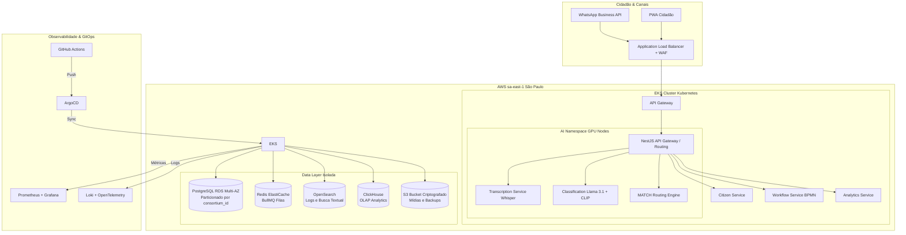

# 🏛️ Zela Nacional · Infraestrutura de Produção

> **Sistema Nacional de Zeladoria Urbana Compartilhada via IA**  
> Arquitetura Cloud-Native, Multi-tenant, GitOps e Compliance LGPD/PL 2338/2023.

Este documento descreve o provisionamento, a segurança e o deploy da infraestrutura real do Zela Nacional na AWS (Região `sa-east-1` - São Paulo), garantindo soberania de dados, alta disponibilidade e escalabilidade para consórcios intermunicipais.

---

## 📐 1. Visão Geral da Arquitetura



---

## 🛠️ 2. Pré-requisitos

Antes de provisionar, certifique-se de ter:
- [ ] Conta AWS com permissões de Administrador e limite de serviço aumentado para instâncias GPU (`g5.xlarge` ou superior) na região `sa-east-1`.
- [ ] AWS CLI configurado (`aws configure`).
- [ ] Terraform (v1.6+) ou OpenTofu instalado.
- [ ] `kubectl`, `helm` e `argocd` CLI instalados.
- [ ] Domínio registrado no Route 53 (ex: `zela.gov.br`) com certificado SSL ACM validado.

---

## 🏗️ 3. Provisionamento da Infraestrutura (Terraform)

A infraestrutura é dividida em módulos para reutilização e segurança.

### 3.1. Estrutura de Diretórios do IaC
```text
infra/
├── environments/
│   └── production/
│       ├── main.tf          # Orquestração dos módulos
│       ├── variables.tf     # Variáveis (ex: vpc_cidr, cluster_name)
│       └── terraform.tfvars # Valores reais de produção (NUNCA commitar secrets)
├── modules/
│   ├── vpc/                 # VPC, Subnets (Public/Private), NAT Gateway, VPC Endpoints
│   ├── eks/                 # EKS Cluster, Managed Node Groups (CPU + GPU)
│   ├── database/            # RDS PostgreSQL, ElastiCache Redis, OpenSearch
│   ├── storage/             # S3 Buckets com KMS e Lifecycle Policies
│   └── security/            # WAF, Security Groups, IAM Roles, KMS Keys
└── helm/                    # Charts customizados para os microsserviços
```

### 3.2. Comandos de Provisionamento
```bash
cd infra/environments/production
terraform init
terraform plan -out=tfplan
terraform apply "tfplan"
```
> **Nota de Compliance:** Todos os recursos são forçados a `region = "sa-east-1"`. O bucket S3 de mídias possui `block_public_access = true` e criptografia SSE-KMS.

---

## 🚀 4. Deploy das Aplicações (GitOps com ArgoCD)

Não fazemos `kubectl apply` manual. O ArgoCD sincroniza o estado do cluster com o repositório Git.

### 4.1. Estrutura do Repositório de Apps
```text
zela-gitops/
├── apps/
│   ├── portal-cidadao/       # Next.js 14 (PWA)
│   ├── portal-consorcio/     # Next.js 14 (Dashboard)
│   ├── portal-prefeitura/    # Next.js 14 + Mobile Web
│   └── portal-nacional/      # Next.js 14 (Admin Zela)
├── services/
│   ├── backend-nestjs/       # Microsserviços Node.js/Go
│   └── ai-fastapi/           # Microsserviços Python (MATCH, Whisper, Llama)
└── argocd/
    ├── projects.yaml         # Isolamento por namespace (cidadao, core, ai)
    └── applications.yaml     # Definição dos sync policies
```

### 4.2. Pipeline de CI/CD (GitHub Actions)
1. **Push na `main`**: Build da imagem Docker, scan de vulnerabilidades (Trivy), push para Amazon ECR.
2. **Atualização do GitOps**: O workflow atualiza automaticamente o arquivo `kustomization.yaml` ou `values.yaml` no repo `zela-gitops` com a nova tag da imagem.
3. **ArgoCD**: Detecta a mudança no Git e realiza o rollout no EKS com estratégia `Blue/Green` ou `Canary` (via Argo Rollouts).

---

## 🧠 5. Infraestrutura de IA e MLOps

A camada de IA exige recursos específicos para baixa latência e alto throughput.

- **Nós GPU no EKS:** Configurar um `NodeGroup` com instâncias `g5.2xlarge` (NVIDIA A10G) e taints para que apenas os pods de IA sejam agendados lá.
- **Modelos:** 
  - *Whisper large-v3*: Rodando via CTranslate2 ou vLLM para otimização de inferência.
  - *Llama 3.1 70B*: Se o custo de GPU for proibitivo no EKS, migrar este microsserviço específico para **Amazon SageMaker Endpoints** com auto-scaling baseado em GPU utilization.
- **Feature Store:** Utilizar Redis ou um banco vetorial (ex: Qdrant/Pinecone, ou pgvector no PostgreSQL) para os embeddings de deduplicação (Sentence-BERT).
- **Drift Detection:** Job cron no Kubernetes rodando `Evidently AI` semanalmente, comparando a distribuição das novas ocorrências com os dados de treino, alertando o canal `#ai-monitoring` no Slack/Teams se o drift ultrapassar 5%.

---

## 🔒 6. Segurança e Compliance (LGPD & PL 2338/2023)

1. **Rede:** VPC com Subnets Privadas para bancos de dados e microsserviços. O acesso à internet de saída passa por NAT Gateway. VPC Endpoints para S3 e ECR (tráfego não sai da rede AWS).
2. **Criptografia:** 
   - Trânsito: TLS 1.3 forçado no ALB e Ingress.
   - Repouso: RDS, EBS, S3 e ElastiCache criptografados com chaves KMS gerenciadas pelo cliente (CMK).
3. **Gestão de Segredos:** Nenhuma senha ou API Key no código. Uso exclusivo do **AWS Secrets Manager** ou **HashiCorp Vault**, injetado nos pods via CSI Driver ou External Secrets Operator.
4. **Audit Trail:** O microsserviço `audit-service` grava em um banco de dados imutável (ou tabela com WORM - Write Once Read Many no S3) todas as decisões da IA (input, modelo, versão do prompt, output, confidence score).
5. **WAF:** AWS WAF configurado no ALB com regras gerenciadas contra SQLi, XSS e rate limiting agressivo no endpoint do WhatsApp Webhook.

---

## 📊 7. Observabilidade e Monitoramento

Stack instalada via Helm no namespace `monitoring`:

- **Métricas:** Prometheus (coleta) + Grafana (dashboards). Dashboards críticos: Latência do MATCH, Taxa de erro do Whisper, Fila do BullMQ, Utilização de GPU.
- **Logs:** Fluent Bit (coleta) → Loki (agregação) → Grafana (visualização). Retenção de 30 dias para logs operacionais.
- **Tracing:** OpenTelemetry Collector enviando traces para AWS X-Ray ou Grafana Tempo, permitindo rastrear uma ocorrência desde o WhatsApp até a gravação no PostgreSQL.
- **Alertas:** Alertmanager configurado para disparar no PagerDuty/Slack se:
  - `confidence_score` médio cair abaixo de 0.6 por mais de 1 hora.
  - Fila de "escalado-humano" ultrapassar 50 itens.
  - Disponibilidade do RDS cair.

---

## 💰 8. Otimização de Custos (FinOps)

Para manter o custo-alvo de **R$ 0,05 por ocorrência**:
1. **Karpenter:** Substituir o Cluster Autoscaler padrão pelo Karpenter para provisionamento de nós mais rápido e barato, desligando nós GPU ociosos à noite (se o perfil de uso permitir).
2. **S3 Intelligent-Tiering:** Para mídias (fotos/áudios) com mais de 30 dias.
3. **Spot Instances:** Usar instâncias Spot para os workers de processamento em lote (ex: jobs de analytics no ClickHouse ou retreinamento de modelos), nunca para o pipeline síncrono de MATCH.
4. **PostgreSQL:** Usar Aurora Serverless v2 para escalar computação do banco de dados automaticamente com base na carga dos consórcios.

---

## 🔄 9. Recuperação de Desastres (DR)

- **RPO (Recovery Point Objective):** < 1 hora (Backups automatizados do RDS e S3 Cross-Region Replication para `us-east-1` apenas como backup frio criptografado).
- **RTO (Recovery Time Objective):** < 4 horas (Scripts Terraform prontos para subir um cluster EKS mínimo em outra AZ ou região em caso de falha catastrófica da `sa-east-1`).

---

## ▶️ 10. Primeiros Passos para a Equipe de DevOps

1. Clone o repositório de infraestrutura.
2. Configure o backend do Terraform (ex: S3 + DynamoDB para state locking).
3. Execute o provisionamento da VPC e EKS.
4. Instale o ArgoCD no cluster e aponte para o repositório `zela-gitops`.
5. Valide os health checks dos 4 portais e dos serviços de IA.
6. Execute o script de `seed` para popular o PostgreSQL com os dados dos consórcios pilotos (CIOP, CIMGA, etc.) e a matriz de competências.

---

> **Aviso Legal:** Esta infraestrutura foi desenhada para cumprir as diretrizes da LGPD (Lei 13.709/2018) e as melhores práticas do PL 2338/2023 (Marco Legal da IA). A responsabilidade final pela validação jurídica dos fluxos de dados e termos de uso é do **AI Owner** e do Comitê de Ética do Consórcio.

--- 

*Documento gerado para a Global Solution 2026.2 · Grupo 8 · Zela Nacional.*
